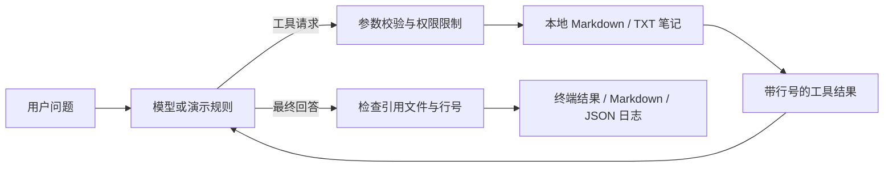

# Study Agent Lab · 学习资料助手

一个适合第一次练习 Agent 开发的小项目：输入问题，Agent 检索本地笔记、读取资料，再给出带行号来源的回答。你可以看到每次工具调用，并导出报告。

**Node.js 22+ · 零第三方依赖 · 中文示例 · 离线演示 · OpenAI Responses API**

## 一分钟体验

```bash
git clone https://github.com/killthtbaby21/study-agent-lab.git
cd study-agent-lab
npm run demo
npm run demo -- "RAG 关键词检索" --save
```

无需 `npm install` 或 API Key。演示模式使用固定规则选择工具，并摘录匹配的原文，**不是大模型自主推理**。它用于观察和调试 Agent 的执行流程。

```text
Study Agent Lab | 离线演示（规则驱动，不调用大模型）
问题：Agent 和普通聊天有什么区别？

[第 1 轮] 选择下一步
  → list_notes {}
[第 2 轮] 选择下一步
  → search_notes {"query":"Agent 和普通聊天有什么区别？"}
[第 3 轮] 选择下一步
  → read_note {"file":"agent-basics.md"}
...
- 普通聊天主要生成文字；Agent 还能调用工具，根据工具结果决定后续行动。 [agent-basics.md:4]
```

完整的实际运行样例见 [examples/demo.md](examples/demo.md)。

## 接入真实模型

复制 `.env.example` 为 `.env`，填写你自己的 API Key 和支持 Responses function calling 的模型 ID：

```dotenv
OPENAI_API_KEY=your_key_here
OPENAI_MODEL=your_available_model_id
```

```bash
npm start -- "结合资料，解释 Agent 与 RAG 的关系，并给出三步学习建议" --save
```

真实模式由模型动态选择工具，并通过多轮 Responses API 完成回答。本项目保留完整输出项，回传 `function_call_output`，使用 `store: false` 和加密 reasoning 项维持无状态多轮上下文。实现依据：[OpenAI 官方 function calling 文档](https://developers.openai.com/api/docs/guides/function-calling)。

真实模式需要你自己的 API 额度；用户问题和工具返回的笔记会发送至 OpenAI。本地未配置 Key 时会明确报错，不会偷偷切换成演示模式。

## 工作原理



| 工具 | 功能 |
| --- | --- |
| `list_notes` | 列出可用笔记 |
| `search_notes` | 英文词与中文双字片段检索，返回前五个文件 |
| `read_note` | 读取笔记的前 160 行，供回答引用 |

这个练习采用关键词检索，没有 embedding 或向量数据库。真实模式最多执行 8 轮决策、20 次工具调用；文件必须在 `knowledge/` 中，大小不超过 64 KiB。工具出错会作为结果交回模型，让模型尝试恢复。

## 换成自己的资料

把非敏感 `.md` 或 `.txt` 笔记放入 `knowledge/`，最多 100 个文件、三层子目录。仅供本机使用的笔记可放在 Git 已忽略的 `knowledge/local/`。重新运行即可，不需要构建索引。

`--save` 将 Markdown 答案和 JSON 运行轨迹存入 `reports/`。JSON 包含实际读取的资料；目录已被 Git 忽略。示例 API Key、个人笔记和运行报告均不要提交到公开仓库。

## 验证

```bash
npm test
npm run eval
```

测试覆盖真实接口请求的模拟、多轮上下文、中文检索、资料不足、路径越界、工具参数错误、调用预算、文件限制和假引用。Windows 无符号链接权限时该项会跳过；Linux CI 可执行该项。

评估使用五个固定的离线问题，检查资料命中和引用结构。**它不衡量真实模型的答案质量。** 实际模型联调需要配置 Key，且要另外人工检查来源是否支持结论。

## 从项目中学什么

建议依次阅读 `src/cli.js` → `src/tools.js` → `src/agent.js` → `src/providers.js`。详见 [七天练习路线](docs/learning-path.md)，包含逐步改造任务、验收方式和项目介绍建议。

```text
src/               CLI、工具、Agent 循环、模型适配器
knowledge/         可替换的中文学习笔记
test/              自动化测试
scripts/           可重复的离线评估
examples/          实际运行样例
docs/              学习路线与设计说明
.github/workflows/ Windows / Linux 自动检查
```

## 当前局限

关键词检索不理解同义词；长笔记只读取前 160 行；没有聊天记忆、联网搜索或 Web 界面。引用校验检查“确实读取过文件且行号存在”，无法判断语义是否支持结论。提示词要求模型忽略资料中的指令，但不能保证杜绝提示注入；工具的文件权限边界由代码执行。

这是个人练习项目。项目介绍应如实描述个人实现与验证结果；只有实际参加了实习，才把经历标注为实习。
